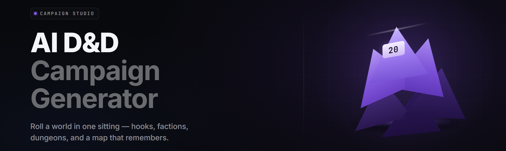

  
  
  

  

  
  

---

**An offline-first AI D&D campaign generator for tabletop DMs who are tired of three-hour session prep and blank-page panic.**

Forge builds full campaigns, session arcs, NPCs with motives, dungeons with spatial logic, encounter balance, loot tables, and lore bibles — all from a prompt, all running locally on your machine, no cloud subscription, no seat fee, no account.

---

## 📖 Overview

AI D&D Campaign Forge is a Windows desktop `.exe` that wraps a local 7B–13B instruction-tuned LLM plus a hand-written rules engine for 5e-compatible systems. You type a seed ("grimdark desert campaign, level 1–12, heavy faction play, political intrigue"), and Forge spits out a structured campaign bible you can export as PDF, Markdown, or Foundry/FoundryVTT JSON.

| Category | Details |
| --- | --- |
| **Product type** | Standalone Windows desktop app (`.exe`, no installer, portable) |
| **Core engine** | Local LLM (GGUF, Q4_K_M default) + deterministic rules layer |
| **Rule systems** | 5e SRD, PF2e-lite, OSR, custom homebrew profiles |
| **Output formats** | Markdown, PDF, JSON (Foundry, Roll20, Obsidian) |
| **Session mode** | Offline · no telemetry · no account · no rate limits |
| **Version** | v2.4.1 (2026 stable channel) |
| **Target user** | DMs, homebrew authors, solo players, indie RPG writers |

Forge is not a chatbot with a D&D skin. It has a real rules engine underneath the generation layer, which is why encounter CR math, XP budgets, loot rarity curves, and dungeon connectivity graphs actually hold together instead of contradicting each other three sessions in.

---

## 📚 What is an AI D&D Campaign Generator

If this is your first time hearing the phrase, here's the glossary.

| Term | Explanation |
| --- | --- |
| **Seed prompt** | The natural-language starting point for the generator — genre, tone, level range, themes. |
| **Campaign arc** | A multi-session narrative spine with a beginning, escalation, midpoint turn, and finale. |
| **Session block** | A single playable session: hooks, scenes, encounters, rewards, cliffhanger. |
| **NPC motive graph** | A directed graph of NPC relationships, goals, and conflicts the AI keeps consistent. |
| **Encounter balance pass** | A rules-engine check that reweights monster counts to hit a target difficulty band. |
| **Lore bible** | The exported reference document — factions, geography, timeline, mysteries. |
| **Continuity ledger** | Internal state that stops the AI from killing the same NPC twice. |

**Why people use one:**

- Cut session prep from 3–4 hours down to 15–30 minutes.
- Generate backups when the party goes somewhere you never planned for.
- Get consistent NPC voices and motives across a 40-session campaign.
- Populate hex crawls and side quests without a notebook of sticky notes.
- Prototype a homebrew setting fast, then rewrite it by hand where it matters.

---

## 🗡️ Key Features

| Feature | Description | Benefit |
| --- | --- | --- |
| Campaign Architect | Full 1–20 arc generation with acts, turns, and a resolved finale. | Never stare at a blank page again. |
| Session Weaver | Splits a campaign into playable 3–4 hour session blocks. | Runs on a schedule instead of vibes. |
| NPC Forge | Names, motives, secrets, stat blocks, and voice notes. | Your innkeeper has a reason to exist. |
| Dungeon Graph | Room-by-room layout with connectivity, keys, and loops. | No more linear corridor slogs. |
| Encounter Balancer | CR, XP budget, and action-economy aware tuning. | Fights land where you wanted them to. |
| Faction Sim | Rival factions advance their goals between sessions. | The world moves when players rest. |
| Loot Curator | Rarity-curved treasure tied to encounter difficulty. | No +3 swords at level 2. |
| Lore Bible Export | One-click PDF/Markdown world reference. | Hand it to a co-DM or a player. |
| Foundry Exporter | Native JSON import for actors, journals, scenes. | Skip the manual re-typing. |
| Continuity Ledger | Persistent state across generated sessions. | Dead NPCs stay dead. |
| Homebrew Profiles | Save custom races, classes, and rules presets. | Your table, your system. |
| Prompt Presets | Genre packs: grimdark, high fantasy, cyber-fantasy, cosmic horror. | Dial the tone in one click. |

---

## 🧩 Grouped Module Catalog

23 modules, grouped by domain. Each table lists **Feature** and its concrete **Effect**.

### ⚔️ Combat & Encounter Modules

| Feature | Effect |
| --- | --- |
| Encounter Balancer | Reweights monster counts to land inside a target CR band per party size. |
| Action Economy Auditor | Flags encounters where legendary actions or swarms break turn pacing. |
| Difficulty Drift Monitor | Warns when a session block trends toward TPW territory. |

### 🏰 Worldbuilding Modules

| Feature | Effect |
| --- | --- |
| Region Builder | Generates hex-region geography with climate, resources, and travel times. |
| Faction Sim | Advances 3–8 factions' goals independently between sessions. |
| Myth Weaver | Produces creation myths, prophecy hooks, and unreliable histories. |
| Timeline Keeper | Maintains an internal calendar that all generated events respect. |

### 🎭 NPC & Social Modules

| Feature | Effect |
| --- | --- |
| NPC Forge | Full stat block + motive + secret + voice tic per NPC. |
| Motive Graph | Links NPCs into a directed conflict graph; prevents contradiction. |
| Dialogue Kit | Sample lines in an NPC's voice, tone-matched to their stats. |
| Rumor Mill | Distributes plot-relevant whispers through taverns and markets. |

### 🕯️ Dungeon & Exploration Modules

| Feature | Effect |
| --- | --- |
| Dungeon Graph | Rooms, corridors, loops, and key-lock progression that holds up. |
| Trap Suggester | Traps scaled to the party's level and skill coverage. |
| Puzzle Factory | Non-combat puzzles with a stated solution and a bypass. |
| Hex Crawl Padder | Fills hexes with encounters, landmarks, and dead drops. |

### 🎒 Rules & Item Modules

| Feature | Effect |
| --- | --- |
| Loot Curator | Rarity-curved treasure tied to encounter difficulty. |
| Magic Item Forge | Custom items with balanced effects and attunement rules. |
| Homebrew Profiles | Slot in your own races, classes, and rules variants. |
| SRD Importer | Pulls in 5e SRD monsters and items as a base layer. |
| Balance Lint | Static check across generated content for out-of-band power. |

### 💾 Export & Integration Modules

| Feature | Effect |
| --- | --- |
| Lore Bible Export | One-shot PDF/Markdown world reference. |
| Foundry Exporter | Actors, journals, scenes as native Foundry JSON. |
| Obsidian Vault Sync | Dumps the whole campaign as linked markdown notes. |
| Session Recap Writer | Auto-summarizes a session block into a player-facing recap. |

---

## 🧭 The Problem

Running a campaign is a second job nobody pays you for.

- Blank-page paralysis: you have a vibe, not a session.
- Notes scattered across three notebooks, two Google Docs, and a group chat.
- NPCs who contradict each other because nobody's tracking motives.
- Encounter math that flips between trivial and a TPK every other week.
- A party that goes off the rails and you have nothing ready.
- Homebrew settings that collapse after session six because factions never move.
- Zero ability to hand your campaign off to a co-DM without a fire hose of context.

---

## 🛠️ The Solution

| Problem | Solution |
| --- | --- |
| Blank-page paralysis | Seed-prompt generator produces a full arc from one sentence. |
| Scattered notes | Single lore bible export, versioned per campaign. |
| Contradictory NPCs | Motive graph + continuity ledger keeps everyone consistent. |
| Broken encounter math | Encounter Balancer runs a real rules pass, not vibes. |
| Off-rails party | On-demand session block generation mid-session. |
| Static homebrew worlds | Faction Sim advances goals between sessions. |
| Co-DM handoff hell | One-click foundry + Obsidian export. |

---

## 🏁 Get Started

1. **Grab the release.** Hit the download below and pull the latest `ai-dnd-campaign-forge` build.
2. **Extract.** Unzip into a folder you control — no admin install, no registry writes.
3. **First launch.** Double-click the `.exe`. Windows SmartScreen may ask once; allow it.
4. **Load a model.** On first run, Forge prompts you to point at a local GGUF model file (or download the recommended one from inside the app).
5. **Forge a campaign.** Type a seed prompt, hit **Forge**, and export when it lands.

### 🗜️ Run the Tool

  

---

## 🎬 Apply Modules — Run Flow

The straight path from download to a playable session:

1. **Extract** the release archive to `C:\DnDForge\` (or anywhere with 25 GB free).
2. **Launch** `.exe`.
3. **Grant** admin rights only if you're writing exports to a protected directory.
4. **Point** Forge at your GGUF model on first run.
5. **Hotkey** — press `Ctrl+Shift+F` to open the Forge palette from anywhere in the app.

> First generation on a mid-tier GPU takes ~40–90 seconds for a full campaign arc. Subsequent sessions are 5–15 seconds because the model stays warm.

---

## 🧪 Usage Guidelines

| Allowed | Not allowed |
| --- | --- |
| Personal, home, and streamed D&D sessions. | Selling Forge itself or its exports as your own product. |
| Homebrew worlds, home rules, custom races. | Redistributing the bundled GGUF model outside the repo. |
| Publishing campaigns you generated on itch.io / DriveThruRPG. | Using Forge to generate content for minors in an exploitative context. |
| Modding the rules layer for your own table. | Rebranding the app and reselling it. |
| Commercial actual-play streams using Forge output. | Claiming Forge is an official WotC product (it isn't). |

---

## 💻 Compatibility / Platform Support

| Platform | Status | Notes |
| --- | --- | --- |
| Windows 11 (x64) | ✅ Full support | Primary target; tested on 23H2+. |
| Windows 10 (x64) | ✅ Full support | 22H2 minimum. |
| Windows on ARM | 🟡 Beta | Runs under emulation; slower generation. |
| Linux (Wine/Proton) | 🟡 Community | Works, no official support. |
| macOS | ❌ Not supported | No native build planned for 2026. |
| Steam Deck (Proton) | 🟡 Community | Playable; model load is slow on SD cards. |

---

## 💡 Tips for Best Results

- Give the seed prompt a **tone** and a **level range** — "grimdark, 1–12, faction-heavy" beats "a fantasy campaign."
- Keep your GGUF model on an SSD. Model load time dominates first-run latency.
- Save Homebrew Profiles for anything you re-use across campaigns.
- Use **Session Recap Writer** after every session to keep the continuity ledger accurate.
- If encounters feel off, run **Balance Lint** before exporting — it catches drift.
- Export to Obsidian if you want to hand-edit the lore between runs.

---

## 🧱 All Modules Status

| Module | Status | Description |
| --- | --- | --- |
| Campaign Architect | ✅ Working | Full-arc generation with acts and turns. |
| Session Weaver | ✅ Working | Splits arcs into playable session blocks. |
| NPC Forge | ✅ Working | Stat block + motive + secret per NPC. |
| Motive Graph | ✅ Working | Directed conflict graph across all named NPCs. |
| Dungeon Graph | ✅ Working | Room-and-corridor layout with progression logic. |
| Encounter Balancer | ✅ Working | CR/XP reweighting to a target band. |
| Faction Sim | ✅ Working | Turn-by-turn faction goal advancement. |
| Loot Curator | ✅ Working | Rarity-curved treasure per encounter. |
| Magic Item Forge | ✅ Working | Custom items with attunement rules. |
| Continuity Ledger | ✅ Working | Persistent cross-session state. |
| Lore Bible Export | ✅ Working | PDF + Markdown world reference. |
| Foundry Exporter | ✅ Working | Native Foundry JSON actors/journals/scenes. |
| Obsidian Vault Sync | ✅ Working | Linked markdown dump per campaign. |
| Session Recap Writer | ✅ Working | Player-facing recap per session block. |
| Region Builder | ✅ Working | Hex geography with climate and travel. |
| Myth Weaver | ✅ Working | Creation myths and prophecy hooks. |
| Timeline Keeper | ✅ Working | Internal calendar everything respects. |
| Dialogue Kit | ✅ Working | Sample lines per NPC voice. |
| Rumor Mill | ✅ Working | Plot whispers routed through NPCs. |
| Trap Suggester | ✅ Working | Level-scaled traps with bypasses. |
| Puzzle Factory | ✅ Working | Solvable puzzles with stated solutions. |
| Hex Crawl Padder | ✅ Working | Hex-fill encounters and landmarks. |
| Balance Lint | ✅ Working | Static power check across all content. |

---

## 🖥️ System Requirements

| Component | Minimum | Recommended |
| --- | --- | --- |
| OS | Windows 10 22H2 (x64) | Windows 11 23H2+ |
| CPU | 4-core x64 | 8-core x64 (modern) |
| RAM | 16 GB | 32 GB |
| GPU | 6 GB VRAM (7B Q4) | 12 GB VRAM (13B Q5) |
| Storage | 25 GB free SSD | 60 GB free NVMe |
| DirectX | DX11 | DX12 |

---

## 📦 Installation

1. Download the release archive using the 

  

 macro at the top of this page.
2. Extract it to a folder you control — no installer, no registry writes, fully portable.
3. Launch the `.exe`, point Forge at a local GGUF model on first run, and start forging.

---

## 🐛 Known Issues

| Issue | Fix |
| --- | --- |
| SmartScreen blocks first launch. | Click "More info" → "Run anyway." Signed builds land in v2.5. |
| Model load is slow on external HDDs. | Move the GGUF to an internal SSD. |
| Foundry import drops token art on some scenes. | Re-export with "Include assets" enabled. |
| PDF export garbles non-Latin names. | Switch the export font to `Noto Sans` in Settings → Export. |
| Faction Sim drifts after 30+ sessions. | Run **Balance Lint** and reset the ledger to the last stable session. |

---

## ⚖️ Comparison

| Aspect | Generic ChatGPT prompt | AI Dungeon-style tools | **AI D&D Campaign Forge** |
| --- | --- | --- | --- |
| Offline / local | ❌ Cloud only | ❌ Cloud only | ✅ Fully local |
| Real rules engine | ❌ | ❌ | ✅ 5e + PF2e-lite + OSR |
| Encounter balance pass | ❌ | ❌ | ✅ Built-in |
| Persistent NPC continuity | Manual | Weak | ✅ Continuity ledger |
| Foundry / Obsidian export | Manual | ❌ | ✅ Native |
| Cost model | Subscription | Freemium | One-time, no account |
| Install path | Web app | Web app | Extract + run `.exe` |

---

## ❔ FAQ

<b>Do I need an internet connection?</b>

No. After the first model download, Forge runs fully offline. No telemetry, no account, no calls home.

<b>Which models does Forge support?</b>

Any GGUF model with an instruction-tuned chat template. The bundled default is a 7B Q4_K_M tuned for D&D-style structured generation.

<b>Can I run it without a GPU?</b>

Yes, on CPU, but expect 3–8 minutes per full campaign arc. A 6 GB VRAM GPU brings that down to under 90 seconds.

<b>Is this official Wizards of the Coast software?</b>

No. Forge is an independent open-source project, unaffiliated with WotC. It references the 5e SRD under the OGL/CC terms.

<b>Can I sell campaigns I generate?</b>

Yes. Forge output is yours to publish, stream, or sell. Only the app itself and the bundled model are covered by their respective licenses.

**Q: Does it work with Roll20?**
**A:** Yes — export to Markdown or Foundry JSON, then import via Roll20's JSON bridge or copy-paste for handouts.

**Q: How big is the download?**
**A:** The app itself is ~110 MB. The recommended GGUF model is a separate 5–8 GB download prompted on first launch.

**Q: Will my homebrew rules survive updates?**
**A:** Homebrew Profiles are stored as plain files in your `profiles/` folder and are never touched by app updates.

**Q: Is there a Linux build?**
**A:** No official one in 2026. Community members run it under Wine/Proton with good results.

---

## 🗝️ Final Download

Everything above ships in one portable archive. Extract, point it at a model, and the next time your party wanders off the map you'll have a dungeon, a faction, and three NPCs with reasons to be there already generated.

  

Take the tater out of the fridge, chef — the campaign's already half-written, you just gotta roll initiative.
